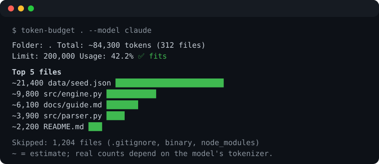

<div align="center">

# 🧮 token-budget

**Scan a folder, count its tokens, and find out if it fits your model's context window.**

[](https://github.com/shadow-lo/token-budget/actions/workflows/test.yml)


[](LICENSE)

[Türkçe](README.tr.md)



</div>

## ✨ Why

Before you paste a project into an LLM you want to know: how many tokens is it, will it fit, and which files are eating the budget? `token-budget` answers that in one command. It runs fully offline and never sends your files anywhere.

## 📦 Install

```bash
pip install token-budget          # or: pipx install token-budget
pip install "token-budget[exact]" # optional: exact counts via tiktoken
```

Python 3.9+. No dependencies for the default mode.

## 🚀 Usage

```bash
token-budget .                                    # scan the current folder
token-budget ./src --model claude --limit 200000  # does it fit 200k tokens?
token-budget . --top 10 --ext .py,.md             # only Python and Markdown
token-budget . --json                             # machine-readable output
```

## ⚙️ Options

| Option | Description |
|---|---|
| `path` | Folder or single file to scan (default `.`) |
| `--model {claude,gpt,gemini}` | Use a nominal context window for that family (200k / 128k / 1M) |
| `--limit N` | Context window in tokens; overrides `--model` |
| `--top N` | Show the N largest files (default 10) |
| `--depth N` | Directory breakdown depth (default 1) |
| `--ext .py,.md` | Only count these extensions |
| `--exclude GLOB` | Skip matching paths (repeatable or comma-separated) |
| `--no-gitignore` | Do not read `.gitignore` files |
| `--exact` | Count with tiktoken instead of estimating |
| `--json` | JSON output (always valid, no color) |
| `--no-color` | Plain output. `NO_COLOR` is respected too |

**Exit codes:** `0` fits (or no limit given), `1` does not fit, `2` error. This makes it usable in CI: `token-budget . --limit 100000`.

## 🎯 How accurate are the numbers?

**Be careful with them: the default mode is an estimate.**

- **Default (offline):** characters ÷ 4, rounded up. Fast and dependency-free, but only approximate. Code, non-English text and JSON often tokenize worse than 4 chars/token, so the real count can be noticeably higher or lower. Every number is shown with a `~`, and `--json` has `"approximate": true`.
- **`--exact`:** uses [tiktoken](https://github.com/openai/tiktoken) (`cl100k_base`). That is an OpenAI tokenizer, so it is exact for that encoding only. For Claude, Gemini and others it is a closer approximation, not the true count.
- The `--model` windows are nominal and change over time. Check your provider's docs, or pass `--limit` yourself.

Leave a safety margin: your prompt, instructions and the model's answer also use the window.

## 🛡️ What gets skipped

- Everything matched by `.gitignore` (nested ones too), plus `--exclude`
- `.git`, `node_modules`, `__pycache__`, virtualenvs and similar tool folders
- Binary files (by extension, or a NUL byte in the first 8 KB)
- Symlinks (never followed, so no loops)
- Unreadable files

The skipped count and reasons are always shown. Large files are read in chunks, and files that are not valid UTF-8 are read with replacement characters instead of failing.

## ⚠️ Limitations

- `.gitignore` support is a built-in matcher: no `.git/info/exclude`, no global excludes file.
- `--exact` uses one encoding; it does not know every model's tokenizer.
- Files you pass through another tool (PDFs, images, notebooks outputs) are not counted as text.
- v1 has no tree view, no "what should I drop" suggestions and no `--watch` (planned).

## 🧪 Development

```bash
pip install -e ".[dev]"
pytest          # fails below 80% coverage; CI runs Linux + Windows
```

## 📄 License

[MIT](LICENSE)
