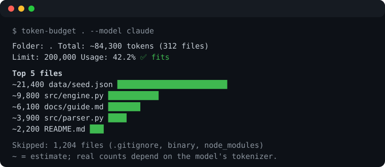

<div align="center">

# 🧮 token-budget

**Bir klasörü tarar, token sayısını hesaplar ve modelin bağlam penceresine sığıp sığmadığını söyler.**

[](https://github.com/shadow-lo/token-budget/actions/workflows/test.yml)


[](LICENSE)

[English](README.md)



</div>

## ✨ Neden

Bir projeyi bir dil modeline vermeden önce şunu bilmek istersin: kaç token, sığar mı, hangi dosyalar bütçeyi yiyor? `token-budget` bunu tek komutla söyler. Tamamen çevrimdışı çalışır, dosyalarını hiçbir yere göndermez.

## 📦 Kurulum

```bash
pip install token-budget          # veya: pipx install token-budget
pip install "token-budget[exact]" # isteğe bağlı: tiktoken ile kesin sayım
```

Python 3.9+. Varsayılan modda bağımlılık yoktur.

## 🚀 Kullanım

```bash
token-budget .                                    # bulunduğun klasörü tara
token-budget ./src --model claude --limit 200000  # 200 bin token'a sığar mı?
token-budget . --top 10 --ext .py,.md             # yalnızca Python ve Markdown
token-budget . --json                             # makine okunur çıktı
```

## ⚙️ Seçenekler

| Seçenek | Açıklama |
|---|---|
| `path` | Taranacak klasör veya tek dosya (varsayılan `.`) |
| `--model {claude,gpt,gemini}` | O model ailesi için varsayılan pencere (200 bin / 128 bin / 1 milyon) |
| `--limit N` | Bağlam penceresi (token); `--model`'i geçersiz kılar |
| `--top N` | En büyük N dosyayı göster (varsayılan 10) |
| `--depth N` | Klasör dökümü derinliği (varsayılan 1) |
| `--ext .py,.md` | Yalnızca bu uzantıları say |
| `--exclude GLOB` | Eşleşen yolları atla (tekrarlanabilir veya virgüllü) |
| `--no-gitignore` | `.gitignore` dosyalarını okuma |
| `--exact` | Tahmin yerine tiktoken ile say |
| `--json` | JSON çıktı (her zaman geçerli, renksiz) |
| `--no-color` | Düz çıktı. `NO_COLOR` değişkeni de dikkate alınır |

**Çıkış kodları:** `0` sığar (veya limit verilmedi), `1` sığmaz, `2` hata. CI'da kullanılabilir: `token-budget . --limit 100000`.

## 🎯 Sayılar ne kadar doğru?

**Dikkat: varsayılan mod bir tahmindir.**

- **Varsayılan (çevrimdışı):** karakter sayısı ÷ 4, yukarı yuvarlanır. Hızlı ve bağımlılıksızdır ama yaklaşıktır. Kod, İngilizce dışı metin ve JSON çoğu zaman 4 karakter/token'dan kötü parçalanır; gerçek sayı belirgin biçimde yüksek veya düşük çıkabilir. Her sayı `~` ile gösterilir, `--json` çıktısında `"approximate": true` yazar.
- **`--exact`:** [tiktoken](https://github.com/openai/tiktoken) (`cl100k_base`) kullanır. Bu OpenAI'ın tokenizer'ıdır; yalnızca o kodlama için kesindir. Claude, Gemini ve diğerleri için daha iyi bir yaklaşıktır, gerçek sayı değildir.
- `--model` pencereleri nominaldir ve zamanla değişir. Sağlayıcının belgelerine bak veya `--limit`'i kendin ver.

Güvenlik payı bırak: istemin, talimatların ve modelin cevabı da pencereden yer kaplar.

## 🛡️ Nelerin atlandığı

- `.gitignore` ile eşleşen her şey (iç içe olanlar dahil) ve `--exclude`
- `.git`, `node_modules`, `__pycache__`, sanal ortamlar ve benzeri araç klasörleri
- İkili dosyalar (uzantıdan veya ilk 8 KB'de NUL baytından)
- Sembolik bağlantılar (hiç izlenmez, döngü olmaz)
- Okunamayan dosyalar

Atlanan sayı ve nedenleri her zaman gösterilir. Büyük dosyalar parça parça okunur; UTF-8 olmayan dosyalar hata vermez, bozuk baytlar yerine değiştirme karakteri konur.

## ⚠️ Sınırlamalar

- `.gitignore` desteği yerleşik bir eşleştiricidir: `.git/info/exclude` ve genel exclude dosyası yoktur.
- `--exact` tek bir kodlama kullanır; her modelin tokenizer'ını bilmez.
- Başka bir araçla işlenen içerik (PDF, resim, not defteri çıktıları) metin olarak sayılmaz.
- v1'de ağaç görünümü, "bunları çıkar" önerisi ve `--watch` yok (planlandı).

## 🧪 Geliştirme

```bash
pip install -e ".[dev]"
pytest          # %80 kapsamanın altında başarısız olur; CI Linux + Windows'ta çalışır
```

## 📄 Lisans

[MIT](LICENSE)
